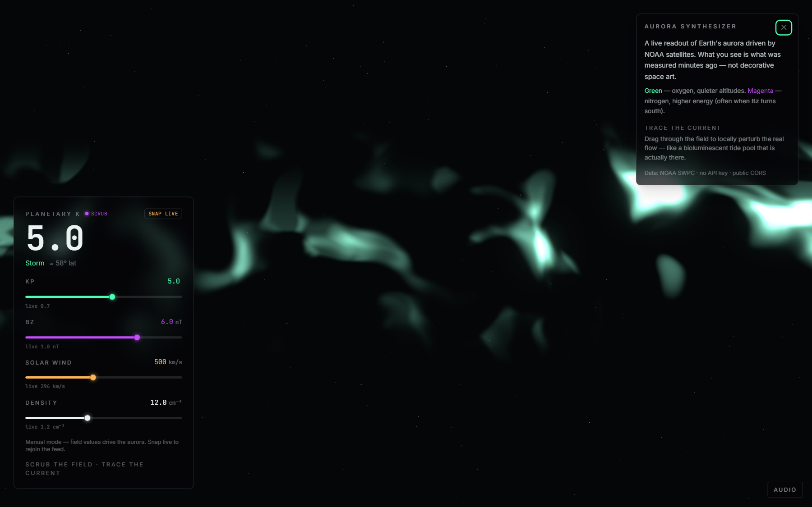
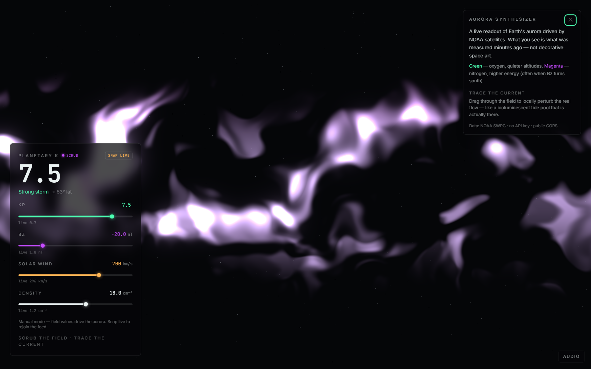

# Aurora Synthesizer

[](./LICENSE)
[](./tsconfig.app.json)
[](./.nvmrc)
[](https://pnpm.io)

> A real-time, playable visualization of Earth’s aurora driven by **live NOAA space weather data**.

This is not decorative space art. It is an **honest instrument**: the field you see is what NOAA satellites measured minutes ago. Dragging or touching the canvas does not invent new data — it **locally perturbs the real underlying flow**, like disturbing a bioluminescent tide pool that is actually there.

**Single job of the page:** in under 10 seconds, feel that you are looking at a living readout of the sun touching the Earth right now.

---

## Screenshots

Instrument HUD with interactive field dials (Kp, Bz, solar wind, density). Scrubbing any dial drives the aurora uniforms immediately; **snap live** rejoins the NOAA feed.

### Green aurora — oxygen / quieter field

Northward or weakly southward **Bz**, moderate **Kp**. Dominant green ribbons (oxygen emission).



### Magenta aurora — nitrogen / energized field

Strongly southward **Bz** and elevated **Kp**. Progressive shift toward magenta/red (higher-energy nitrogen).



| Mode | Typical dials | Look |
|------|----------------|------|
| **Green** | Bz ≳ 0 nT, moderate Kp | Cool cyan–green curtains |
| **Magenta** | Bz ≪ 0 nT, high Kp | Violet–magenta storm ribbons |

---

## Features

- **Custom GLSL aurora** — domain-warped simplex + curl noise; no particle libraries
- **Live NOAA SWPC data** — Kp, Bz, solar wind speed/density, OVATION (public, keyless)
- **Interactive field dials** — scrub telemetry to reshape color, height, flow, and density in real time
- **Pointer / touch** — local curl perturbation with ~1.5s decay; multi-touch ignored
- **Instrument HUD** — Kp readout, LIVE / SCRUB status, legend, calibration boot sequence
- **Optional audio** — restrained Web Audio drone mapped to Bz (pitch) and wind (level)
- **Performance budget** — pixel-ratio caps, FPS watchdog, noise-octave degradation
- **Fallbacks** — WebGL failure → static data instrument; `prefers-reduced-motion` respected
- **Accessibility** — screen-reader live region, keyboard-focusable panels, focus rings
- **Zero secrets for MVP** — pure static deploy (Vercel / Cloudflare Pages)

---

## Quick start

**Requirements:** Node.js 20+ and [pnpm](https://pnpm.io) 9+

```bash
pnpm install
pnpm dev
```

Open the URL printed by Vite (default `http://localhost:5173`).

```bash
pnpm build    # typecheck + production bundle
pnpm preview  # serve dist/
pnpm lint     # oxlint
```

No environment variables are required for the MVP.

---

## Tech stack

| Area | Choice |
|------|--------|
| App | Vite, React 19, TypeScript (strict) |
| Rendering | Three.js, `@react-three/fiber`, `@react-three/drei` |
| Post-FX | `postprocessing` / `@react-three/postprocessing` (real bloom) |
| State | Zustand |
| Data | TanStack Query (3 min stale/refetch) |
| UI chrome | Tailwind CSS v4 |
| Audio (optional) | Native Web Audio API only |

See [docs/ARCHITECTURE.md](./docs/ARCHITECTURE.md) for structure and design rules.

---

## Data sources

All endpoints are **public, keyless, and CORS-open**. No auth for MVP.

| Product | Endpoint |
|---------|----------|
| Planetary K-index | `https://services.swpc.noaa.gov/products/noaa-planetary-k-index.json` |
| IMF Bz (summary) | `https://services.swpc.noaa.gov/products/summary/solar-wind-mag-field.json` |
| Solar wind speed | `https://services.swpc.noaa.gov/products/summary/solar-wind-speed.json` |
| Plasma density (RTSW) | `https://services.swpc.noaa.gov/json/rtsw/rtsw_wind_1m.json` |
| OVATION aurora | `https://services.swpc.noaa.gov/json/ovation_aurora_latest.json` |

Polled every **~3 minutes**. Do not poll faster against public NOAA services.

> Legacy paths `/products/solar-wind/mag-1-day.json` and `plasma-1-day.json` return **404** as of 2026. This project uses the summary + RTSW feeds above.

Details and parsing notes: [docs/DATA.md](./docs/DATA.md).

---

## Project layout

```
src/
  api/           # NOAA fetch + types
  components/
    scene/       # WebGL canvas, aurora plane, stars, bloom
    ui/          # Instrument HUD, telemetry dials, fallback, a11y
  hooks/         # Weather polling, interaction, reduced-motion, audio
  shaders/       # Custom GLSL (source of visual truth)
  store/         # Zustand global state (live feed + field dials)
  utils/         # Colors, WebGL detection
docs/
  images/        # README screenshots
  ARCHITECTURE.md
  DATA.md
  DEPLOYMENT.md
```

---

## Deployment

Static SPA — no backend, no secrets for MVP.

| Platform | Notes |
|----------|--------|
| **Vercel** | Import repo; framework preset Vite; output `dist` |
| **Cloudflare Pages** | Build `pnpm build`, output `dist` |

See [docs/DEPLOYMENT.md](./docs/DEPLOYMENT.md).

If you later add a keyed API (e.g. NASA DONKI): **never** put keys in client code or `VITE_*` vars. Proxy via a serverless function; keep secrets in `.env.local` only (gitignored).

---

## Accessibility & performance

- Canvas is **not** required to understand the data — Kp and conditions are in the HUD and an `aria-live` region.
- Full keyboard use for info/legend controls; visible `:focus-visible` rings.
- Target **60 fps** on mid-range hardware; degrade octaves / DPR before dropping frames.
- `prefers-reduced-motion`: heavy flow cap, no interaction turbulence.

---

## Contributing

Contributions are welcome. Please read [CONTRIBUTING.md](./CONTRIBUTING.md) and our [Code of Conduct](./CODE_OF_CONDUCT.md).

For security issues, see [SECURITY.md](./SECURITY.md) — do not open public issues for vulnerabilities.

---

## Credits & attribution

- **Space weather data:** [NOAA / NWS Space Weather Prediction Center (SWPC)](https://www.swpc.noaa.gov/) — public data products.
- **Simplex noise:** Ashima Arts / Ian McEwan (public domain-style GLSL, widely reused).
- **Rendering:** [Three.js](https://threejs.org/), [React Three Fiber](https://docs.pmnd.rs/react-three-fiber), [postprocessing](https://github.com/pmndrs/postprocessing).

This project is **not** affiliated with NOAA. Data accuracy depends on upstream SWPC feeds and network conditions.

---

## License

[MIT](./LICENSE) © 2026 Krish Kamra

---

## Thesis

> Observatory control room meets the aurora itself — a scientific instrument that happens to be beautiful.
